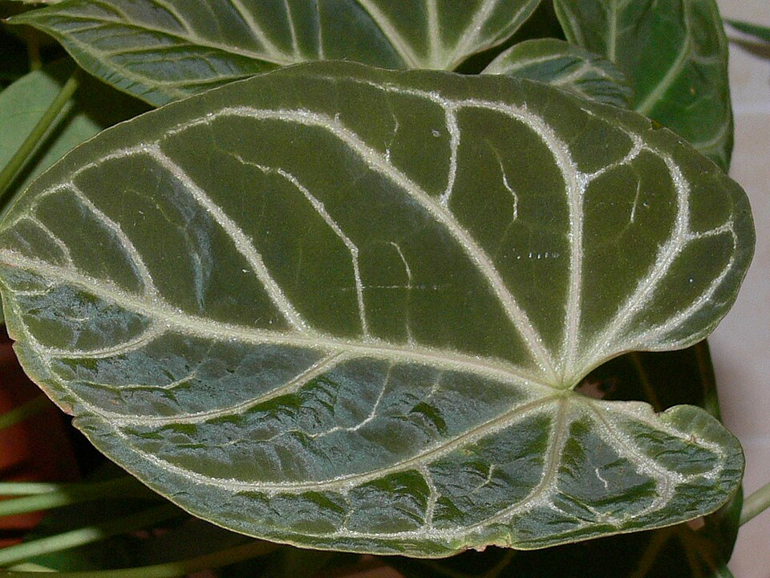
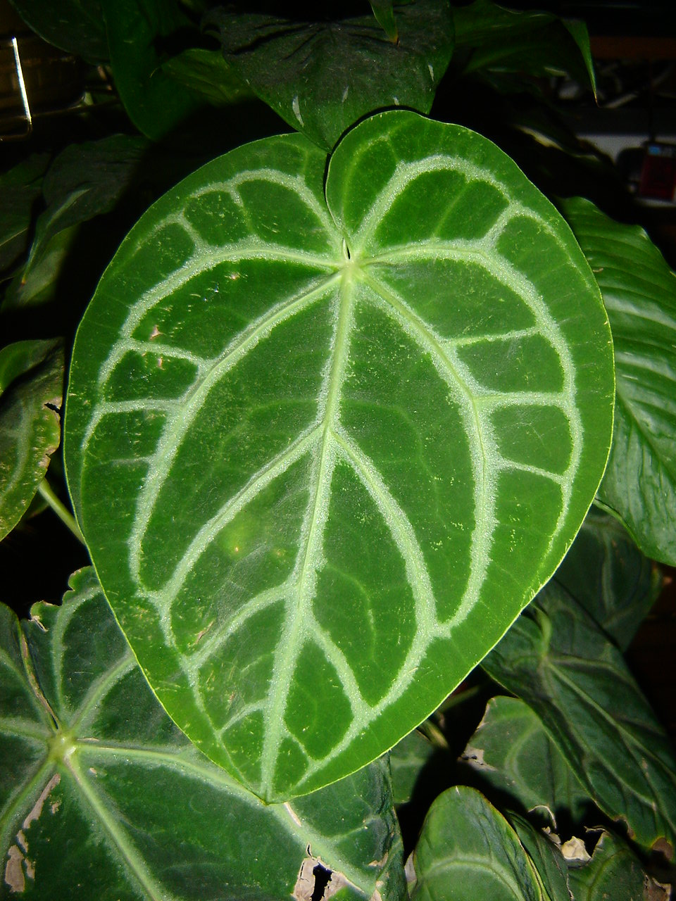
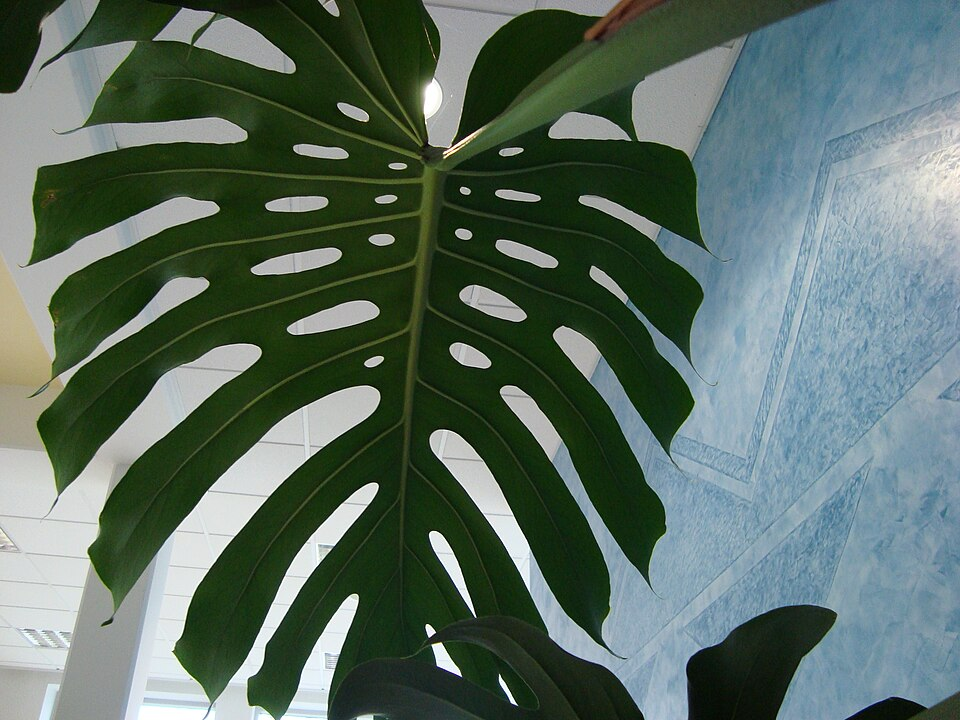
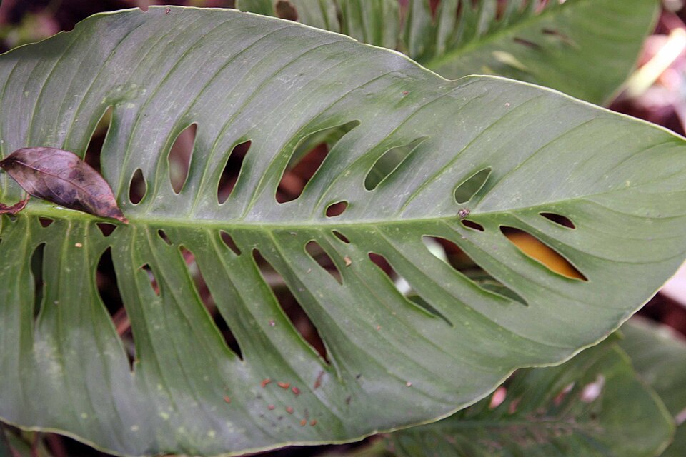
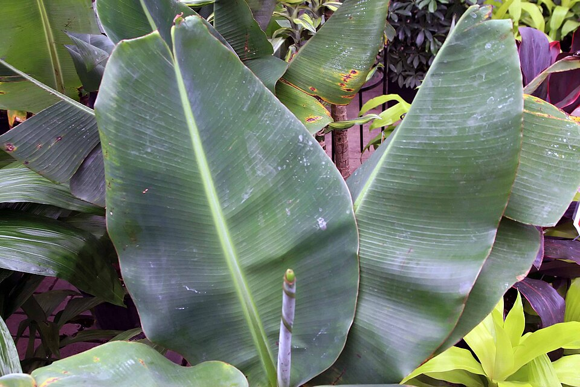
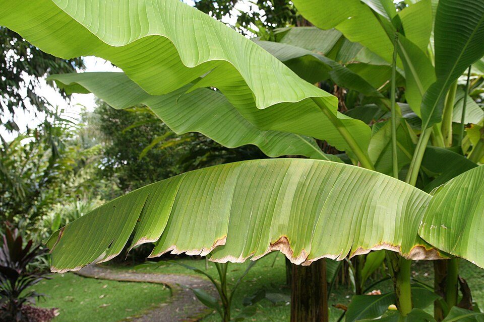
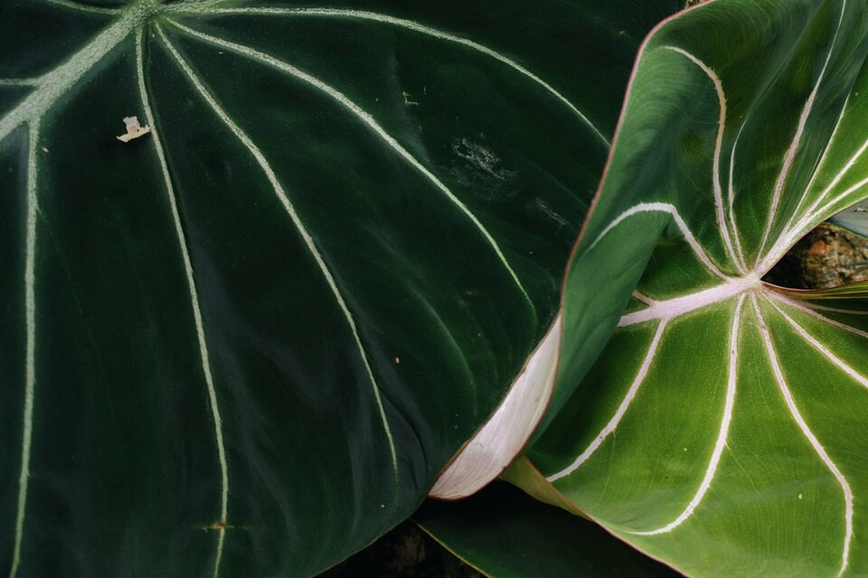
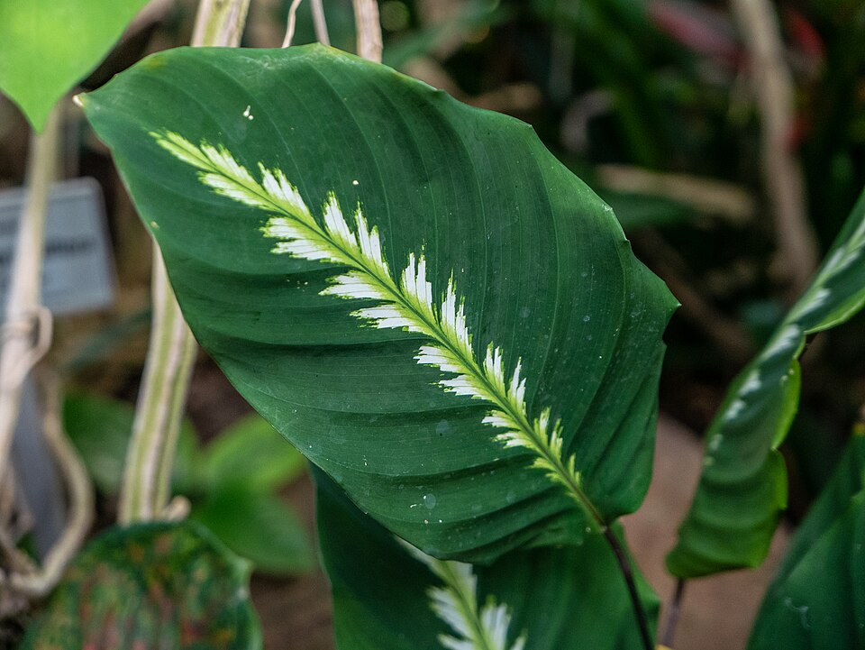

# 热植壁纸参考图（待确认）

以下 8 张真实植物摄影仅用于确认植物形态、材质、层次与配色，不是正式壁纸，不代表已完成构图。Behance 与 Pinterest 当前检索返回 HTTP 403，先采用可核验作者和许可的 Wikimedia Commons 摄影，并保留原站检索入口。

默认构图方向：植物在左侧、左下和底部自然舒展；右侧 40% 为安静办公区，摆动范围也不进入核心留白。确认植物质感后再制作静态构图，再确认运动预览。

- [Behance 检索](https://www.behance.net/search/projects?search=Anthurium%20Monstera%20botanical%20wallpaper)
- [Pinterest 检索](https://www.pinterest.com/search/pins/?q=botanical%20wallpaper%20anthurium%20monstera)

参考图中的拍摄背景、盆器与标签不作为正式场景内容。正式素材另行制作分层资产与授权记录，不将网站截图或这些完整照片直接塞入安装包。

## 01 · 水晶花烛：心形叶片、叶脉与柔和质感

[作品与原图页面](https://commons.wikimedia.org/wiki/File:Anthurium_crystallinum_leaf.JPG) · 作者：Pajast · 许可：Public domain

## 02 · 水晶花烛：绒面叶与低饱和深绿

[作品与原图页面](https://commons.wikimedia.org/wiki/File:Anthurium_crystallinum-leaf.jpg) · 作者：Abrimaal at Polish Wikipedia · 许可：CC BY-SA 2.5

## 03 · 龟背竹：真实裂叶与自然比例

[作品与原图页面](https://commons.wikimedia.org/wiki/File:Monstera_deliciosa_DSC02605.jpg) · 作者：Smatu · 许可：CC BY-SA 4.0

## 04 · 洞洞龟背竹：孔洞与层叠遮挡

[作品与原图页面](https://commons.wikimedia.org/wiki/File:Monstera_adansonii_1zz.jpg) · 作者：Photo by David J. Stang · 许可：CC BY-SA 4.0

## 05 · 芭蕉：舒展大叶与柔和叶缘

[作品与原图页面](https://commons.wikimedia.org/wiki/File:Musa_acuminata_3zz.jpg) · 作者：Photo by David J. Stang · 许可：CC BY-SA 4.0

## 06 · 芭蕉群落：叶片高低与自然组团

[作品与原图页面](https://commons.wikimedia.org/wiki/File:Musa_basjoo_13zz.jpg) · 作者：Photo by David J. Stang · 许可：CC BY-SA 4.0

## 07 · 其他观叶植物：灰绿、心形叶和细节

[作品与原图页面](https://commons.wikimedia.org/wiki/File:Philodendron_gloriosum_leaves_-_closeup.jpg) · 作者：Theoperatingsystem · 许可：CC BY-SA 4.0

## 08 · 深绿叶面的柔和光线与背景虚化

[作品与原图页面](https://commons.wikimedia.org/wiki/File:Foliage_patterns_Tropical_Dome_Brisbane_Botanic_Gardens_Mt_Coot-tha_L1020717.jpg) · 作者：John Robert McPherson · 许可：CC BY-SA 4.0
