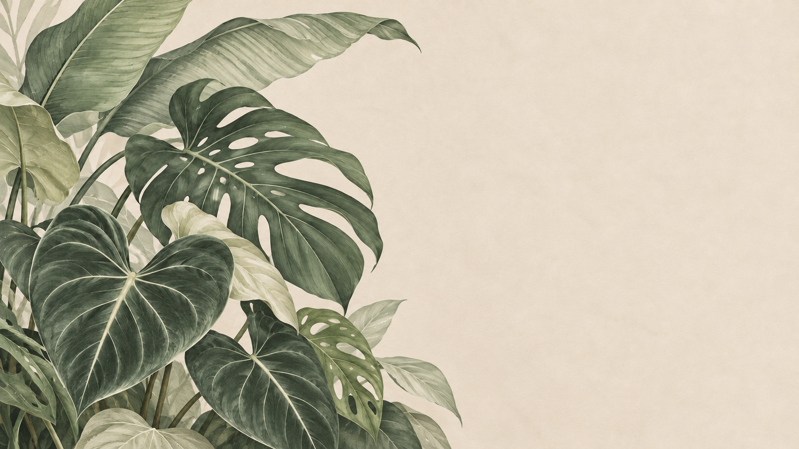

# 热植壁纸静态构图 · 已确认

依据你选择的 **03、04、06、08** 制作的原创插画评审稿：低饱和灰绿、暖灰纸感、柔和叶脉与投影；植物集中在左侧和左下，右侧约 40% 为连续的安静办公留白。

本图由本次图像生成流程原创绘制，不直接打包参考网站原图。当前是静态方向评审，现已继续制作独立图层与原生窗口运动预览，见 [分层审阅](../../review/README.md)；疏密／留白多布局及动态桌面尚未完成。实际源稿为约 16:9 的预览尺寸，不能将其称为已验证的 4K 素材。

用户已确认构图，当前继续：拆分／重绘独立植物与叶片图层，标定连接点和运动边界，制作轻柔运动预览；Windows 动态桌面集成另行验证，不能用这张图替代软件验收。
