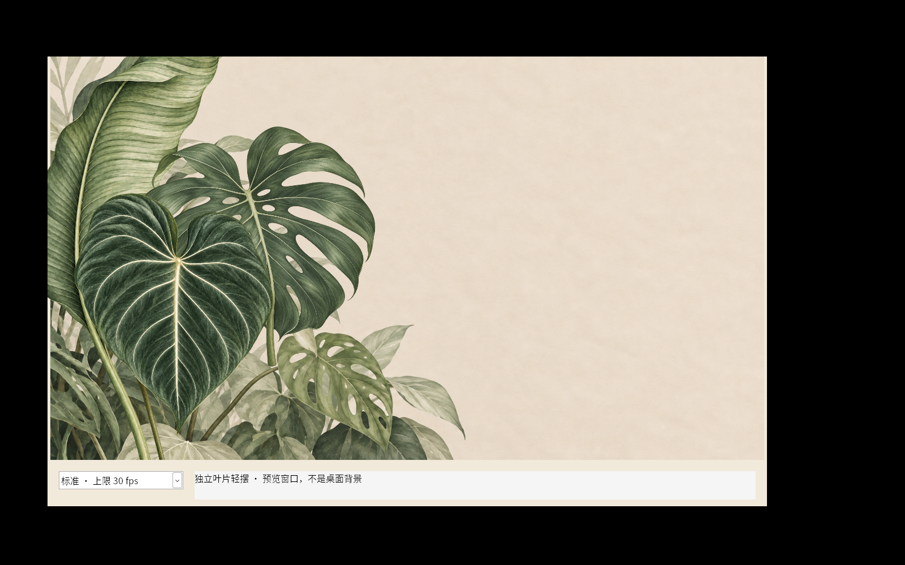
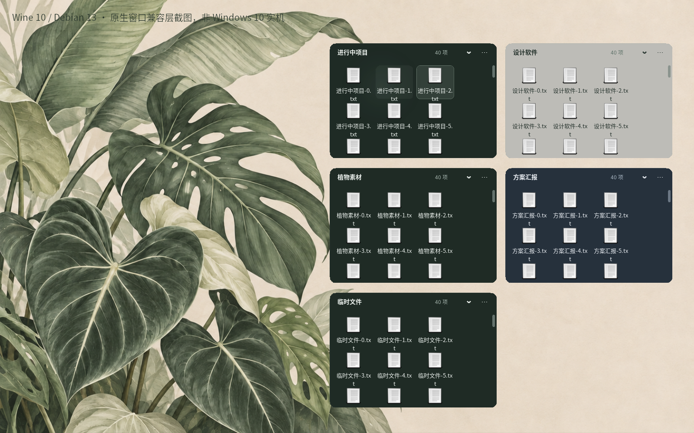
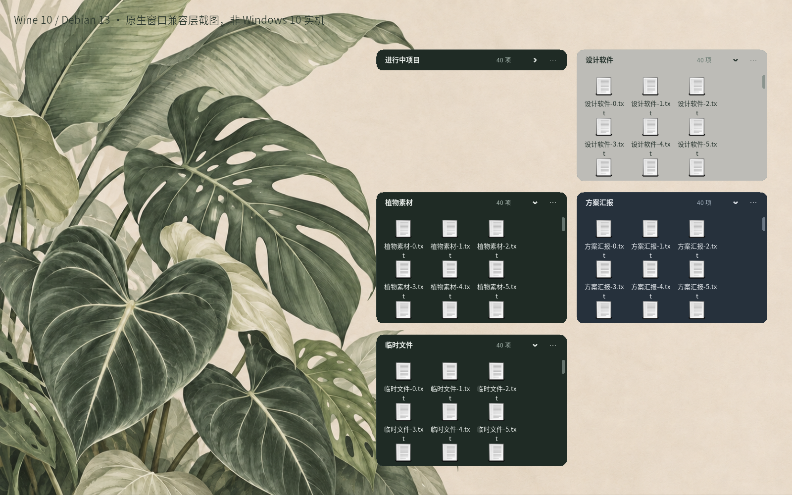
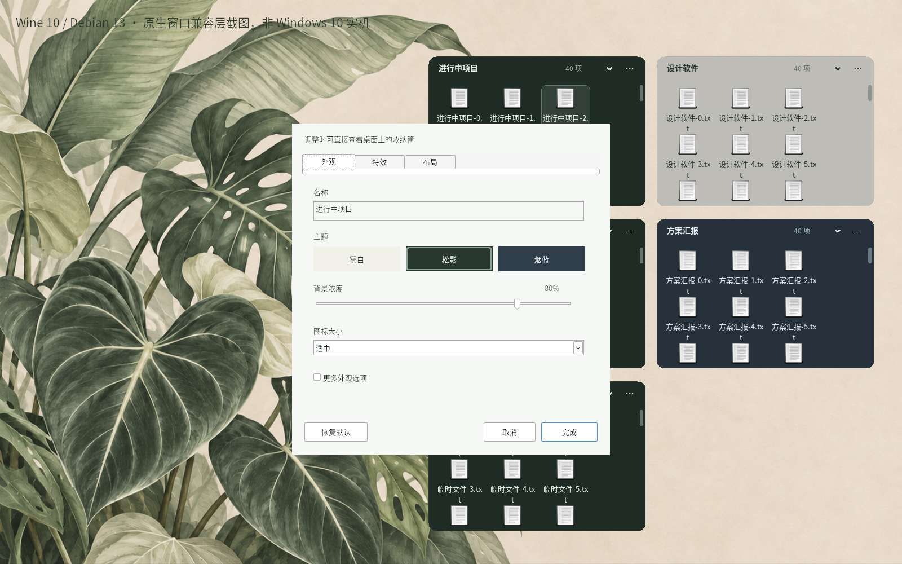
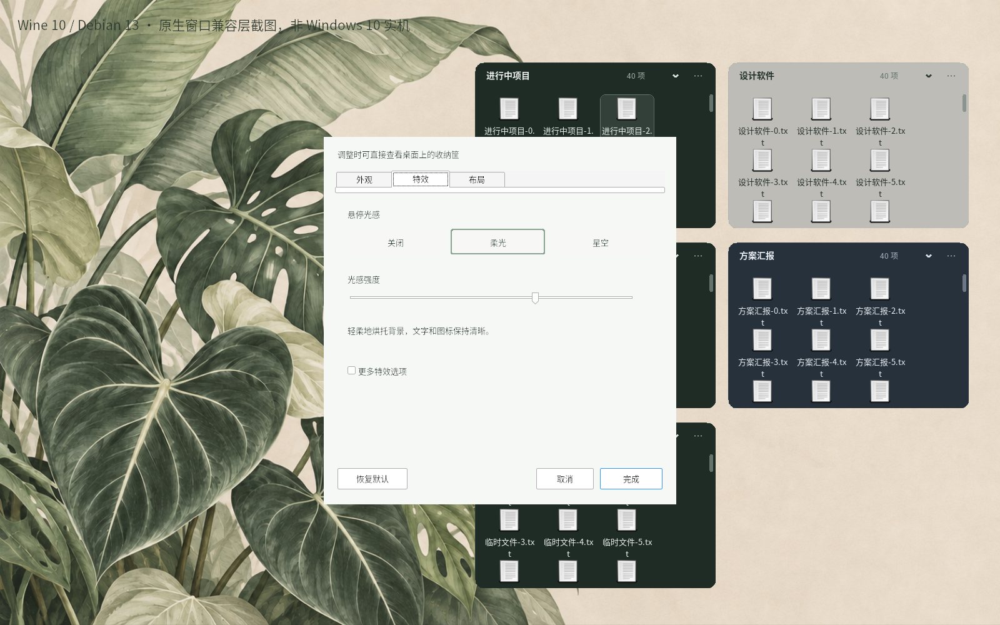
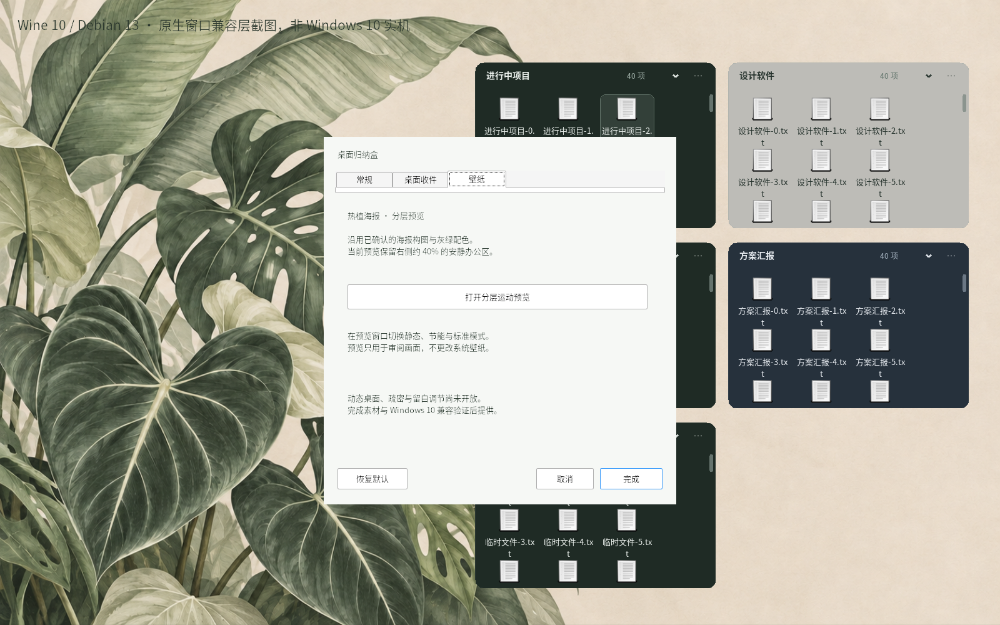

# 原生界面与分层运动审阅 · 0.2.0

以下内容为 **Wine 10／Debian 13 兼容层中实际运行的 Win32、GDI+、Direct2D/WIC 窗口**，不是网页演示，也不是 Windows 10 实机证据。文件均为测试创建的临时样本，未使用真实工作桌面。画面中的植物来自本次原创生成素材，原生桌面壁纸集成尚未实现。

## 先看运动

[下载／播放 15 秒叶片运动录屏（MP4，150 帧，10 fps 采样）](wallpaper-motion-wine.mp4)

<video src="wallpaper-motion-wine.mp4" controls muted></video>

固定纸感背景，花烛、龟背竹、芭蕉分别围绕连接点缓慢微摆，异步周期约 9–13 秒，动态相对静态姿态的摆幅小于约 1.6°，右侧约 40% 保留安静区域。录屏为 10 fps 采样，预览标准渲染上限 30 fps；不把采样率当作性能实测。默认节能模式降低到上限 15 fps 并减少运动叶片，静态无帧定时器。图层边缘透明，画面裁剪防止叶柄进入底栏。

沿用已经确认的海报设计方向；独立叶片为重绘图层，组合与原静态稿有局部差别，供继续审阅。没有将实拍照片或 Rawpixel 库图打包为正式素材。

**尚缺：**真正动态桌面挂载、桌面图标接管／恢复、多种留白布局／疏密／色调，以及经验证的原生 4K 资源。当前源码图层尺寸与来源见 [素材记录](../../assets/wallpaper/provenance.json)，不能将此预览窗口称为已验收的动态壁纸。

## 收纳筐与设置

截图运行 5 框／200 个临时引用，窗口未通过真实 Explorer 桌面挂载。为便于一屏比较，截图测试布局覆盖较宽区域；程序不会读取用户原生图标位置或自动移动已有筐迁就壁纸。字体在兼容环境使用 Noto CJK 替换，不能据此推断实际 Windows 字体和 DPI 表现完全相同。

本轮依据 Desktop Frames+、Lively Wallpaper、WPF UI 的 [源码研究与采用记录](../references/open-source/README.md)，统一主题与交互，修正目录监听、队列、暂停及过亮光感。完整结果和未验证项见 [测试报告](../测试报告.md)。

## 复现

`tests/visual_capture.cpp` 创建临时样本和原生窗口，输出六个状态截图。`tests/wallpaper_tests.cpp --capture` 在原生预览中播放 20 秒并继续执行停止／清理检查。Linux 开发录屏工具 `tools/capture-x11.cpp` 只读取隔离 Xvfb 的实际像素，由 FFmpeg 编码为 MP4；不合成界面。需要 X11 开发头文件／库和 FFmpeg，这些仅供开发，未放入安装包。不要将录屏工具用于用户正在使用的桌面。
